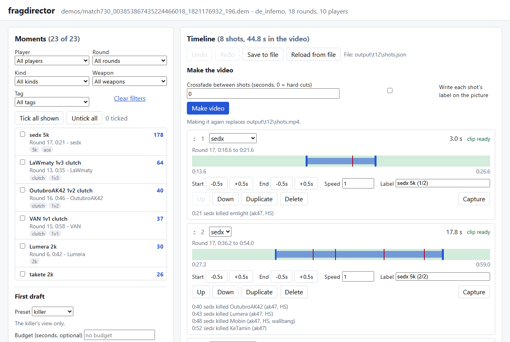
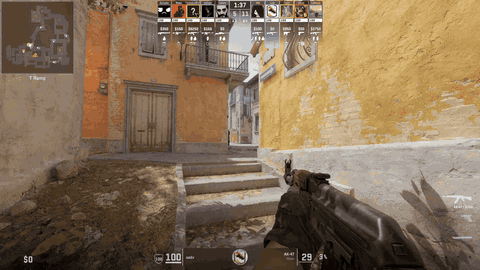

# fragdirector

Turn a CS2 demo (`.dem`) into a finished highlight video, with the play shown
from the killer's view and from each victim's view in the seconds before they
died.





The only input is the `.dem` file. fragdirector reads the exact kill data in
the demo, suggests the moments worth showing, and lets you edit the result in a
browser before it records anything. It never analyses video files and never
needs you to record gameplay yourself.

## What you need

- **Python 3.12** or newer.
- **FFmpeg** on your PATH. `fragdirector render` needs it; `fragdirector
  capture` needs **FFmpeg 8.0 or newer**.
- **For capture only:** Windows, Steam, and CS2 installed. CS2 must be closed
  when you start a capture; fragdirector starts it for you.

Analysis, the editor and rendering of existing clips work on any system with
Python and FFmpeg. Capture is Windows only.

You also need a `.dem` file of a match. Put it anywhere; the examples below use
`demos/`, which Git ignores.

## Install

```bash
git clone https://github.com/<your-account>/fragdirector.git
cd fragdirector
pip install -e ".[dev]"
fragdirector --help
```

## Quick start

1. **See what is in the demo.** Lists the players, the kills, and the best
   moments (multi-kills and clutches), best first.

   ```bash
   fragdirector analyze demos/match.dem
   ```

2. **Make a first-draft shot list.** The preset decides how time is given to
   each shot: `killer` (default), `victims`, `major-replay`, or `budget`.

   ```bash
   fragdirector plan demos/match.dem --preset major-replay --top 5 --out shots.json
   ```

3. **Edit it in the browser.** This starts a local page; nothing leaves your
   machine.

   ```bash
   fragdirector open demos/match.dem --shots shots.json
   ```

   The left side lists every moment; tick the ones you want and apply a preset.
   The right side is the timeline. Drag the ends of a shot or use the
   `±0.5 s` buttons to change its length, and use the buttons to delete,
   duplicate, reorder, change whose view is shown, set the speed, or add a
   shot by hand. Undo and redo are available. **Save to file** writes
   the shot list to the file given by `--shots`.

4. **Record the clips** (Windows, CS2 closed). fragdirector starts CS2, replays
   the demo, and records one clip per shot into `clips/` next to the shot list.
   It runs by itself and can be stopped and started again; finished clips are
   skipped.

   ```bash
   fragdirector capture shots.json
   ```

   The editor's **Capture** button does the same for a single shot.

5. **Join the clips into one video.**

   ```bash
   fragdirector render shots.json --out highlight.mp4
   ```

   Options: `--crossfade 0.4` for fades between shots, `--labels` to write
   each shot's label on the picture for its first seconds. The editor's
   **Make video** button does the same.

Run `fragdirector <command> --help` for every option. Add `--dry-run` to
`capture` or `render` to see what would happen without starting the game or
writing a video.

## Known limits

- **No sound.** Clips and videos are picture only.
- **Slow motion** repeats frames: at 0.5x the picture changes 30 times a
  second. Higher capture frame rates are untested.
- **Capture is real time.** Each clip takes about as long as its length plus
  the time CS2 needs to start and seek. A slow PC gives choppy clips.
- **CS2 updates** can change the demo format or the console commands.
- **Detection is first guesses.** The scoring weights and flick threshold have
  not been tuned on many demos; the editor is where you correct the picks.

## What it does on your machine

- **The editor** is a web server on `127.0.0.1` only, running while
  `fragdirector open` runs. It has no login: any program on your PC can use
  it, other PCs and other web sites cannot. It reads and writes one shot list
  file (the one given by `--shots`) and one video next to it.
- **Capture** starts CS2 through Steam with `-insecure` (demo playback only,
  never a VAC-secured game) and with the game's TCP console open. That
  console listens on every network interface while the game runs; a random
  password made for each run protects it. fragdirector closes the game when
  the capture ends and never closes a game it did not start.
- **FFmpeg** is run to record the game window and to join the clips. It only
  reads the clips folder and writes into it and to the video file.
- **Shot lists and demos from other people** are treated as untrusted: a
  shot list can only name ticks, a player and a demo file, and a demo path
  that points at a network share is not opened unless you pass it yourself
  with `--demo`. The demo is read by the
  [demoparser2](https://github.com/LaihoE/demoparser) library.

Nothing is sent anywhere. To report a security problem, open an issue.

## Files

| Path | What it is |
|---|---|
| `src/fragdirector/parse.py` | Reads the demo (kills, rounds, players, bomb events) |
| `src/fragdirector/detect/` | Finds moments: multi-kills, clutches, flicks, timings |
| `src/fragdirector/score.py`, `weights.default.toml` | Ranks moments; the weights are editable |
| `src/fragdirector/director.py`, `presets/` | Turns moments into a shot list |
| `src/fragdirector/models.py`, `edits.py` | The shot list and the edit operations |
| `src/fragdirector/server.py`, `web/` | The local editor |
| `src/fragdirector/capture/` | Drives CS2 and records the clips |
| `src/fragdirector/render.py` | Joins the clips with FFmpeg |
| `docs/` | How capture and rendering work, and the shot list format |
| `PLAN.md` | The plan and the task list |

## Contributing

See [CONTRIBUTING.md](CONTRIBUTING.md).

## License

MIT. See [LICENSE](LICENSE).
